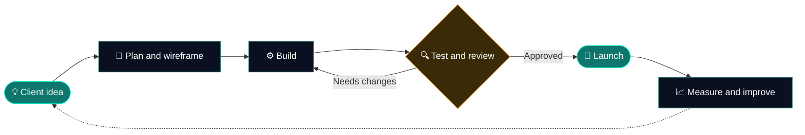

<!-- ============================================================
  Profile README  |  gaber111
  Repo name must be exactly:  gaber111   (Public, with README.md)
  Upload this README.md together with the /assets folder.
  Search for "TODO" and fix repo names / demo links before publishing.
============================================================= -->

<div align="center">

<a href="https://github.com/gaber111">
  
</a>

<br/>

[](https://www.linkedin.com/in/ahmed-gaber-0424bb344)
[](https://linktr.ee/ahmedgaber)
[](mailto:ahmed.kh.gaber111@gmail.com)

<p>
  <a href="#about">About</a> &nbsp;•&nbsp;
  <a href="#tools">Tools</a> &nbsp;•&nbsp;
  <a href="#panel">Control Panel</a> &nbsp;•&nbsp;
  <a href="#projects">Projects</a> &nbsp;•&nbsp;
  <a href="#workflow">Workflow</a> &nbsp;•&nbsp;
  <a href="#experience">Experience</a> &nbsp;•&nbsp;
  <a href="#contact">Contact</a>
</p>

</div>

---

<a name="about"></a>

## 👋 About Me

<table>
<tr>
<td width="60%" valign="top">

🚀 **Founder of a marketing agency** who builds websites and digital products for real clients.

🎓 Student at the **Faculty of Computers and Information, Mansoura University**.

💻 I build with **HTML, CSS, JavaScript, C# and Bootstrap**, and I also program inside **Microsoft Office**.

🎨 I care about how things *feel* to use: clear layouts, smooth interactions, details that make people smile.

📊 I like turning numbers into decisions, so I build with data in mind.

🎬 I have a background in **video editing and graphic design**.

💬 Ask me about: **web development, booking systems, and bringing a business idea online**.

</td>
<td width="40%" align="center" valign="middle">


</td>
</tr>
</table>

<div dir="rtl" align="right">

أنا **أحمد خالد جابر**، طالب في **كلية الحاسبات والمعلومات – جامعة المنصورة**، وصاحب وكالة تسويق. بطمح أتميز في تطوير البرمجيات وأقدّم حلول تقنية مبتكرة. اكتسبت مهارات تقنية وتنظيمية من خلال مشاريع حقيقية ومشاركات مجتمعية وتطوعية. بهتم إن الواجهات تكون سهلة وممتعة في الاستخدام، وإن القرارات تتبني على بيانات.

</div>

```bash
$ whoami
> Ahmed Gaber | Web Developer & Founder

$ cat about.txt
> Student  : Faculty of Computers & Information, Mansoura University
> Role     : Founder of a Marketing Agency
> Mindset  : Build -> Ship -> Learn -> Improve

$ status
> Open to collaborations, freelance projects, and new ideas
```

---

<a name="tools"></a>

## 🧰 Languages & Tools I've Placed My Hands On

<div align="center">


</div>

---

<a name="panel"></a>

## 🧭 Control Panel

<div align="center">


</div>

---

<a name="projects"></a>

## 🚀 Featured Projects

> 👇 Click any project to expand its details.

<details open>
<summary><b>🌙 Gaber Group · Ramadan Kareem</b> — a Ramadan imsakiyah app built for an advertising company</summary>

<br/>

- 🕌 Prayer times for all five prayers, with the **adhan** and prayer reminders
- 🔔 **Notifications** so users never miss a prayer
- 📅 A full Ramadan **calendar**: suhoor, iftar, taraweeh and tahajjud times
- 📻 **Live Quran radio**, streaming directly inside the app
- 📍 Choose your **country or location** to get accurate times

🔗 [View on GitHub](https://github.com/gaber111/Gaber_Group_RamadanKareem) <!-- TODO: confirm repo name / add Live Demo -->

</details>

<details>
<summary><b>✋ Camera Draw</b> — draw in the air with your finger</summary>

<br/>

- 📷 Opens your **camera live** and tracks your hand in real time
- ☝️ **Open finger** to draw, **closed finger** to stop
- 🖐️ **Open palm** and move it to erase what you drew
- 🎨 Pick any **color** and **brush size**, all live in front of the camera
- 🧒 Made for kids and for learning through play

🔗 [View on GitHub](https://github.com/gaber111/Camera-Draw) <!-- TODO: confirm repo name / add Live Demo -->

</details>

<details>
<summary><b>🔤 FRANKO</b> — Arabic ⇄ Franco translator</summary>

<br/>

- 🔁 Translate from **Arabic to Franco** and back, both directions
- ⚡ Instant results while you type

🔗 [View on GitHub](https://github.com/gaber111/FRANKO) <!-- TODO: confirm repo name / add Live Demo -->

</details>

<details>
<summary><b>💈 H-Parber</b> — online booking for a barbershop</summary>

<br/>

- 📆 Customers **book their slot** online in a few taps
- 💬 The shop instantly receives a **message** with the customer's name and time
- 🧩 Built for a real barbershop, to replace phone calls and paper notes

🔗 [View on GitHub](https://github.com/gaber111/H-Parber) <!-- TODO: confirm repo name / add Live Demo -->

</details>

<details>
<summary><b>💌 LOVE</b> — a private, password-protected gift website</summary>

<br/>

- 🔐 Opens only with a **secret password**, even the developer doesn't know it
- 🖼️ Photos and shared memories
- 🎵 Songs, messages and confessions
- 🎁 The giver chooses exactly what goes inside, and I build it

🔒 *Private project: the code and content stay private.*

</details>

> More projects are on the way. Check my repositories for the latest. 🔧

---

<a name="workflow"></a>

## 🔄 How I Work



---

<a name="experience"></a>

## 💼 Experience

| Role | Where | What I do |
|---|---|---|
| **Founder** | Marketing Agency | Leading the agency and delivering digital products and web solutions for clients |
| **Web Developer** | Freelance / Client work | Building websites and apps: booking systems, a Ramadan app, translators, interactive tools |
| **Student** | Faculty of Computers & Information, Mansoura University | Studying computer science and software development |
| **Volunteer** | Social & community activities | Organizing, collaborating and building teamwork skills |

## 🎯 What I Bring

| Area | Strength |
|---|---|
| 🎯 **Product thinking** | Turning a client's need into a clear, usable interface |
| 📊 **Data mindset** | Using numbers and user behavior to guide decisions |
| 🧩 **Problem solving** | Real-time features, location-based logic, notifications, hand tracking |
| 🤝 **Teamwork** | Volunteer and social activities, client communication |

---

<a name="contact"></a>

<div align="center">

### 🤝 Let's Work Together

[](https://www.linkedin.com/in/ahmed-gaber-0424bb344)
[](https://linktr.ee/ahmedgaber)
[](mailto:ahmed.kh.gaber111@gmail.com)

<br/>

*Build something. Learn something. Keep going.* ✨


</div>
